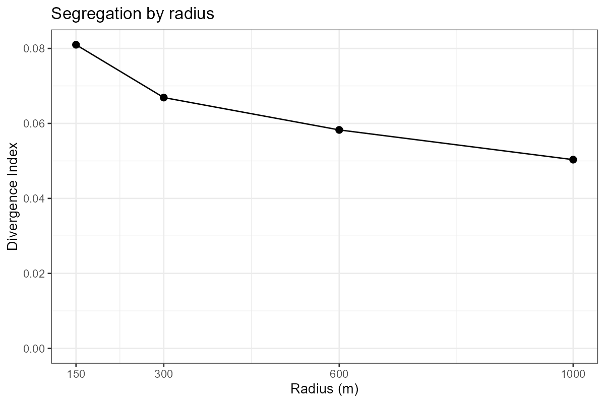
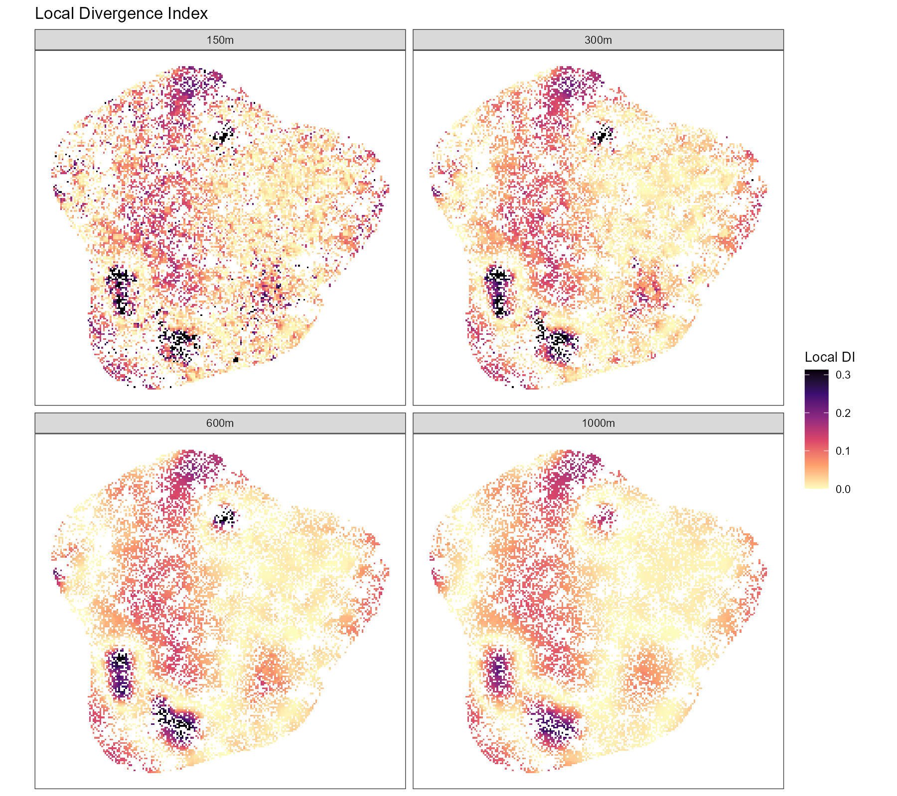

# Multiscale Divergence Index

R code to measure residential segregation at several spatial scales with the
spatial Divergence Index (Roberto 2015), on a 100 m population grid.

Groups: born in Sweden (`sb`), born in Europe (`fb_e`), born outside Europe (`fb_ne`).

## Method

For every populated 100 m cell in the study area (municipality code 180), the
group counts of all cells whose centre lies within a radius of 150, 300, 600 or
1000 m are summed; the cell itself is included, and cells in a 10 km buffer
around the study area count as neighbours. The local Divergence Index is

DI = Σ pg · log(pg / rg)

where pg is a group's share of the local population and
rg its share in the whole study area. The overall DI at each radius
is the mean of local DI weighted by each cell's population.

## Data

The analysis was developed on Swedish register data for Stockholm (2022),
aggregated to 100 m cells. Those data cannot be shared, so this repository
contains **simulated data** for a fictional city instead
(`data/simulated_grid_2022.csv`, made by `simulate_grid_data.R`). The simulated
grid has the same columns as the real one and was calibrated only to
city-wide aggregates (number of cells, persons per cell, group shares, DI by
radius). **All results below are for the simulated city, not for Stockholm.**

## Results (simulated data)

| Radius | DI | Median local DI | 90th percentile local DI |
|---|---|---|---|
| 150 m | 0.081 | 0.051 | 0.161 |
| 300 m | 0.067 | 0.039 | 0.133 |
| 600 m | 0.058 | 0.031 | 0.121 |
| 1000 m | 0.050 | 0.029 | 0.111 |

## Reproducing

1. Run `simulate_grid_data.R` to create `data/simulated_grid_2022.csv`.
2. Run `divergence_multiscale.R` with `in_file` set to that file.
   Results and figures are written to `results/`.

Packages: dplyr, tidyr, readr, ggplot2.

## Reference

Roberto, E. (2015). The Divergence Index: A decomposable measure of segregation
and inequality. arXiv:1508.01167

